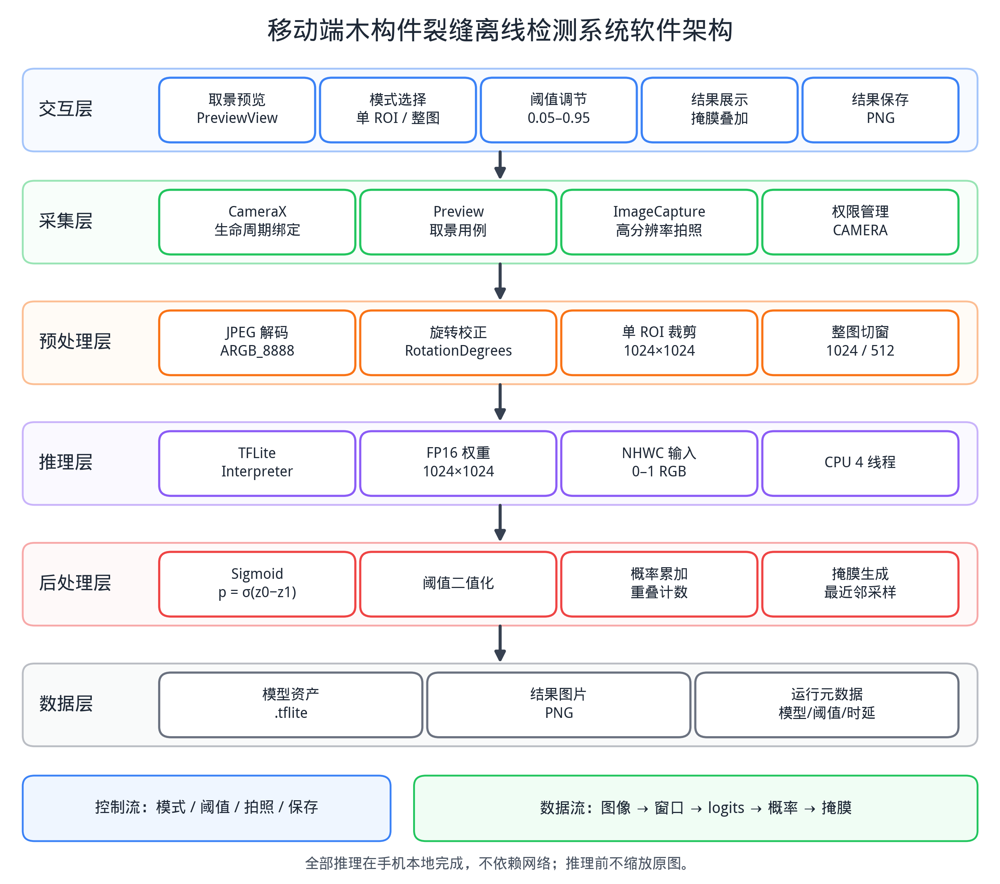
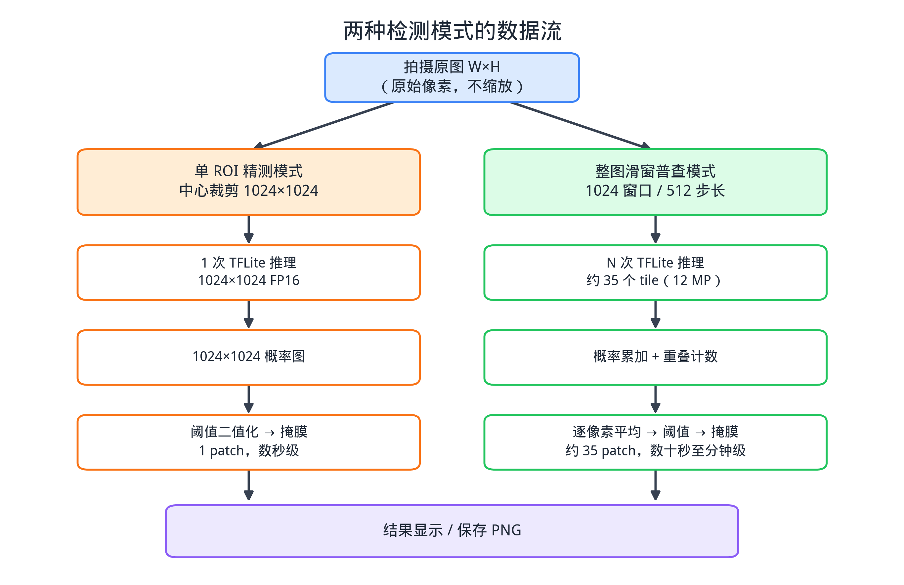

# CrackEdge


面向古建筑木构件裂缝的 **Android 离线检测 App**：拍照后在手机本地完成 1024×1024 裂缝分割，不依赖网络，图像和模型不出本地。

> 这是论文配套的研究原型，不是生产级 App。模型精度、机型兼容性和现场效果仍在持续验证。

## 功能

- **拍照式检测**：CameraX 拍摄高分辨率照片，避免实时视频流的低分辨率与抖动
- **单 ROI 精测**：中心裁剪 1024×1024 原生像素，一次推理
- **整图滑窗普查**：1024 窗口 / 512 步长，逐 tile 推理并拼接概率图
- **FP16 TFLite**：约 43 MB，float32 输入/输出，CPU 4 线程
- **会话历史**：最多 10 张，上一张/下一张回看
- **结果保存**：PNG 写入 App 私有目录，不申请相册权限
- **可观测性**：文件日志、metrics.csv、崩溃日志、模型 SHA256
- **完全离线**：无网络权限、无遥测、无云端上传

## 架构





```text
CameraX ImageCapture
  → JPEG
  → Bitmap 解码 + 旋转（后台）
  → 单 ROI 裁剪 / 整图滑窗
  → TFLite FP16 推理
  → sigmoid + 阈值
  → 概率累加 / 平均
  → 掩膜叠加显示 / 保存 PNG
```

代码结构：

```text
android/app/src/main/java/com/gzt/crackedge/
├── MainActivity.java       UI 与流程编排
├── CameraController.java   CameraX 预览/拍照/生命周期
├── CrackDetector.java      TFLite 加载/单 tile 推理
├── SlidingWindowEngine.java 切窗/概率累加/平均（纯函数）
├── AppConfig.java          常量配置
├── AppLogger.java          logcat + 文件日志
├── MetricsLogger.java      metrics.csv
├── ModelInfo.java          模型资产/输入尺寸/格式/SHA256
└── CrashHandler.java       崩溃日志
```

更详细的模块说明见 [docs/ARCHITECTURE.md](docs/ARCHITECTURE.md)。

## 模型

| 项目 | 内容 |
|---|---|
| 文件 | `android/app/src/main/assets/best_fold1_1024_fp16.tflite` |
| 大小 | 约 43 MB |
| 输入 | `[1, 1024, 1024, 3]` float32，NHWC，0–1 |
| 输出 | `[1, 1024, 1024, 2]` float32 logits |
| 格式 | FP16 权重，float32 计算 |
| 结构 | YOLOv11-U-Net 语义分割学生，约 22.35 M 参数 |

模型来源、转换命令和校验和见 [model/README.md](model/README.md)。

> 这是研究检查点，精度不是本仓库的 SOTA 声明。论文中的 5 折结果与仓库内检查点可能不是同一份权重，请以模型卡片为准。

## 下载

- [GitHub Releases](https://github.com/xxxolllllllll/crack-edge/releases)
- 当前 `v0.1.0` 为 debug 签名，仅用于测试

## 构建

要求：

```text
JDK 17
Android SDK 34
Android 7.0（API 24）及以上设备
```

```bash
cd android
./gradlew assembleDebug
```

APK：

```text
android/app/build/outputs/apk/debug/app-debug.apk
```

安装：

```bash
adb install -r android/app/build/outputs/apk/debug/app-debug.apk
```

如果本地没有配置 Android SDK，创建 `android/local.properties`：

```properties
sdk.dir=/path/to/Android/Sdk
```

## 使用

1. 打开 App，授予相机权限；
2. 选择“单 ROI（1024）”或“整图滑窗（1024）”；
3. 对准裂缝，点击“拍照检测”；
4. 拍完可以继续拍，检测在后台排队；
5. 点“本次历史 (N)”查看结果，上一张/下一张浏览；
6. “保存结果”导出 PNG。

阈值默认 0.50，可在界面调节。

## 日志与指标

```text
Android/data/com.gzt.crackedge/files/logs/app.log
Android/data/com.gzt.crackedge/files/logs/crash_*.txt
Android/data/com.gzt.crackedge/files/metrics.csv
Android/data/com.gzt.crackedge/files/results/*.png
```

用 adb 拉取：

```bash
adb pull /sdcard/Android/data/com.gzt.crackedge/files/metrics.csv
adb pull /sdcard/Android/data/com.gzt.crackedge/files/logs/app.log
```

`metrics.csv` 字段见 [docs/BENCHMARK.md](docs/BENCHMARK.md)。

## 已知限制

- 研究原型，未做应用商店发布与长期现场验证；
- 当前模型精度低于 CrackMamba / SCSegamba 等专用裂缝模型；
- 整图滑窗在低端手机上可能耗时数十秒到数分钟；
- 仅验证 Android，未支持 iOS；
- debug 签名，不适合直接分发；
- 12 MP 大图 + 整图概率图内存占用较高。

## 路线图

- [x] CameraX 拍照 + TFLite FP16 推理
- [x] 单 ROI / 整图滑窗
- [x] 会话历史 / PNG 保存
- [x] 日志 / 指标 / 崩溃日志 / 模型 SHA256
- [x] Gradle Wrapper / CI
- [x] CameraController / CrackDetector / SlidingWindowEngine 拆分
- [x] SlidingWindowEngine 单元测试
- [ ] 真机多机型基准
- [ ] Release 签名与正式发布
- [ ] 小模型（YOLO11n/s）消融
- [ ] 现场视频与长期稳定性测试

## 许可

- 代码：Apache License 2.0，见 [LICENSE](LICENSE)；
- 模型权重、自建数据集、Bridge Crack Dataset 的条款见 [NOTICE](NOTICE)；
- Bridge Crack Dataset：CC BY 4.0，DOI [10.5281/zenodo.17905739](https://doi.org/10.5281/zenodo.17905739)。

## 引用

如果本项目对你的研究有帮助，请引用：

```bibtex
@software{crackedge2026,
  title  = {CrackEdge: Android offline crack detection for historic timber members},
  author = {Zeng, Guangtao},
  year   = {2026},
  url    = {https://github.com/xxxolllllllll/crack-edge}
}
```


